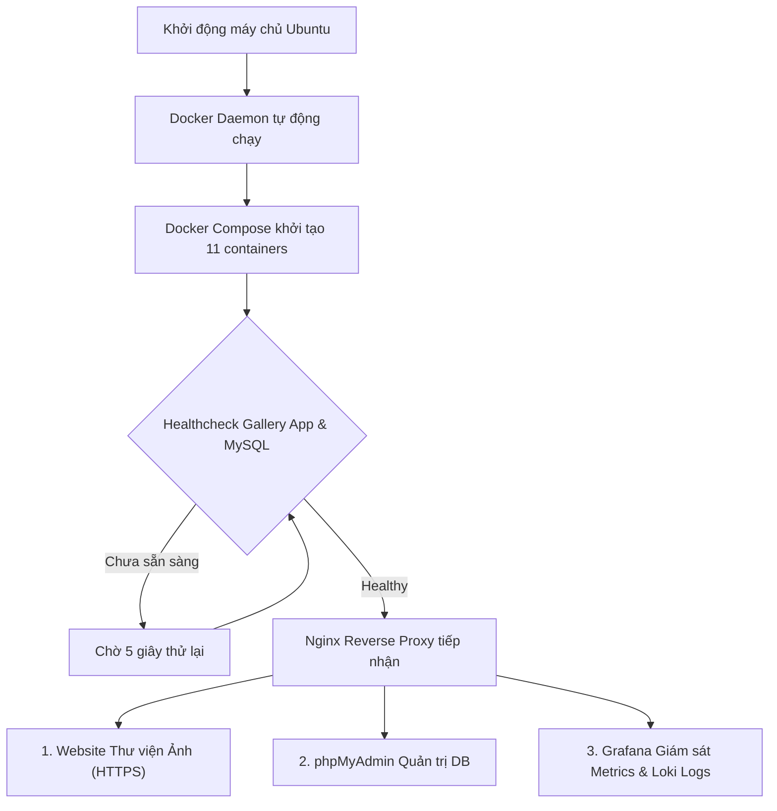

# BÁO CÁO MÔN HỌC: QUẢN TRỊ VÀ TRIỂN KHAI HỆ THỐNG PHẦN MỀM - ĐỀ 31
# HƯỚNG DẪN TỰ ĐỘNG HÓA KHỞI ĐỘNG HỆ THỐNG ĐỀ 31
**Học phần:** Triển khai và quản trị hệ thống phần mềm  
**Đề tài:** Đề 31 – Hệ thống Thư viện Ảnh / Gallery Management System  
**Sinh viên thực hiện:** Nguyễn Thành Long  
**Mã sinh viên:** DTC245200171  
**Lớp:** CNTT K23C  

---

## 1. Mục đích xây dựng tính năng

Tự động hóa toàn diện quy trình kiểm thử và khởi động hệ thống Gallery DevOps trên môi trường máy chủ Ubuntu, đảm bảo tính sẵn sàng cao, phục hồi tự động khi máy ảo hoặc dịch vụ gặp sự cố.

---

## 2. Quy trình khởi động



---

## 3. Các kịch bản vận hành nhanh

```bash
# Cài đặt và triển khai 1 lệnh duy nhất
bash setup.sh

# Kiểm tra toàn diện sức khỏe hệ thống
bash verify.sh

# Kiểm thử tính năng Rate Limiting (giới hạn tần suất)
bash test-ratelimit.sh

# Dừng và giải phóng an toàn tài nguyên
bash teardown.sh
```
